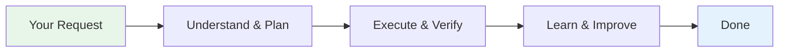

## Welcome to Gem Team

Gem Team adds a **coordinated engineering workflow** to your AI coding tool. Instead of one prompt producing one output, you get a pipeline that plans, builds, reviews, and learns—automatically.

## Quick Navigation

  

    <h3>🚀 Quick Start (5 min)</h3>
    
Install and run your first task

    <a href="/getting-started/quick-start" class="text-primary">Start Quick Start →</a>
  

  

    <h3>📦 Installation</h3>
    
Detailed setup for your tool

    <a href="/getting-started/installation" class="text-primary">View Installation →</a>
  

  

    <h3>🧠 Core Concepts</h3>
    
Understand the mental model

    <a href="/getting-started/concepts" class="text-primary">Learn Concepts →</a>
  

  

    <h3>🎯 First Steps</h3>
    
Guided first task walkthrough

    <a href="/getting-started/first-steps" class="text-primary">Walk Through →</a>
  

---

> **Tip**: New to AI-assisted engineering? Start with [Quick Start](/getting-started/quick-start). Experienced? Jump to [Installation](/getting-started/installation) for your specific tool.