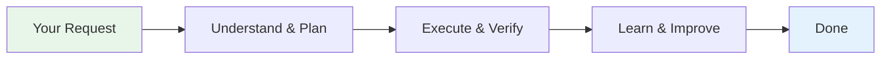

## Welcome to Gem Team

Gem Team adds a **coordinated engineering workflow** to your AI coding tool. Instead of one prompt producing one output, you get a pipeline that plans, builds, reviews, and learns—automatically.

### What Gem Team Does

- **Classifies** every request (complexity, risk, intent) before any work starts
- **Plans** multi-file work into ordered waves with scoped handoffs per agent
- **Executes** through specialist agents: implementer, reviewer, debugger, researcher, and more
- **Verifies** with TDD, risk-based review, security and accessibility checks
- **Learns** after success: high-confidence patterns promoted to repo memory as skills

### What Gem Team Does Not Do

- Does not replace your AI coding tool — it coordinates it
- Does not inspect your repository during Phase 0 classification
- Does not retry blindly — every failure gets a classification and a handler
- Does not write code as the Orchestrator — specialists do all implementation

## Quick Navigation

  

    <h3>🚀 Quick Start (5 min)</h3>
    
Install and run your first task

    <a href="/getting-started/quick-start" class="text-primary">Start Quick Start →</a>
  

  

    <h3>📦 Installation</h3>
    
Detailed setup for your tool

    <a href="/getting-started/installation" class="text-primary">View Installation →</a>
  

  

    <h3>🧠 Core Concepts</h3>
    
Understand the mental model

    <a href="/getting-started/concepts" class="text-primary">Learn Concepts →</a>
  

  

    <h3>🎯 First Steps</h3>
    
Guided first task walkthrough

    <a href="/getting-started/first-steps" class="text-primary">Walk Through →</a>
  

---

### Choose Your Entry Point

| You are...                     | Start Here                                    | Why                                           |
| ------------------------------ | --------------------------------------------- | --------------------------------------------- |
| First-time user                | [Quick Start](/getting-started/quick-start)   | Install + first task in 5 minutes             |
| New to AI-assisted engineering | [First Steps](/getting-started/first-steps)   | Full end-to-end example                       |
| Setting up for a team          | [Installation](/getting-started/installation) | Project-scoped install, version pinning       |
| Wanting the mental model       | [Core Concepts](/getting-started/concepts)    | Orchestrator, phases, waves, handoffs, memory |

> **Tip**: Start with [Quick Start](/getting-started/quick-start) if you've never used Gem Team. Use [Installation](/getting-started/installation) for your specific tool setup.
