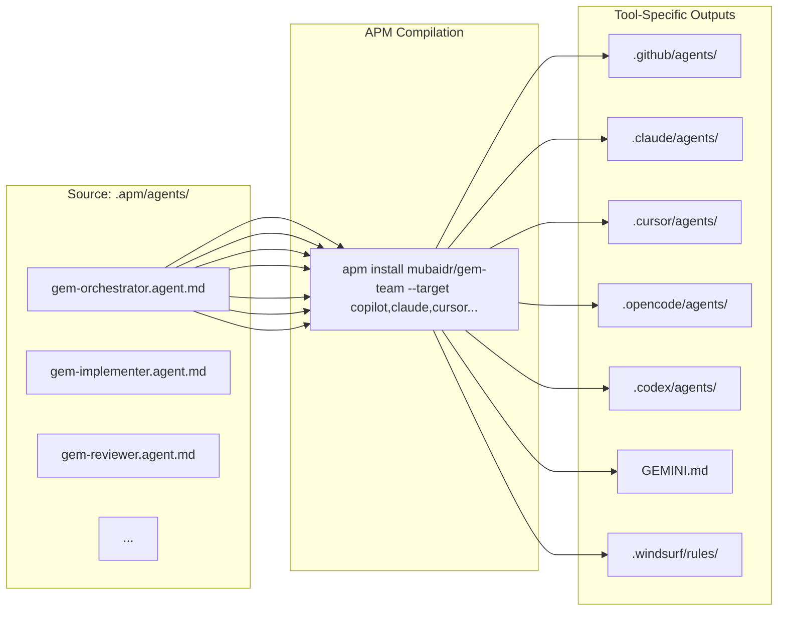

---

title: Works With Your Tools
description: One workflow across Copilot, Claude, Cursor, Codex, Gemini, Windsurf, and OpenCode.
navigation:
  icon: i-lucide-blocks
seo:
  title: Compatibility — Gem Team
  description: "Model and tool compatibility: Copilot, Claude Code, Cursor, Codex, Gemini, Windsurf, OpenCode."
  ogTitle: Compatibility — Gem Team
  ogDescription: Model and tool compatibility for Gem Team.
---


## Universal Agent Definitions

Gem Team agent definitions are **tool-agnostic YAML contracts** compiled by APM for each target.



---

## Supported Targets

| Target | Tool | Output Location | Notes |
|--------|------|-----------------|-------|
| `copilot` | VS Code Copilot / GitHub Copilot CLI | `.github/agents/`, `.github/instructions/`, `.github/prompts/`, VS Code MCP | Full support |
| `claude` | Claude Code | `.claude/agents/`, `.claude/rules/`, commands, skills, hooks, MCP | Full support |
| `cursor` | Cursor | `.cursor/agents/`, `.cursor/rules/`, skills, commands, hooks, MCP | Full support |
| `opencode` | OpenCode | `.opencode/agents/`, commands, skills, MCP, compiled instructions | Full support |
| `codex` | Codex CLI | `.codex/agents/`, `AGENTS.md`, Codex config | Full support |
| `gemini` | Gemini CLI | `GEMINI.md`, skills/instructions, config | Full support |
| `windsurf` | Windsurf / Cascade | `.windsurf/rules/`, skills, commands, hooks, MCP | Full support |

> **APM compiles or skips unsupported primitives** for each target — no manual adaptation needed.
>
> :::tip[PRO TIP]
> Install once with APM, use everywhere. The same `plan.yaml` works across all tools.
> :::

---

## Installation Per Tool

### Universal (APM) — Recommended
```bash
curl -sSL https://aka.ms/apm-unix | sh
apm install mubaidr/gem-team --target copilot,claude,cursor,opencode,codex,gemini,windsurf
```

### Tool-Specific Marketplace

<details>
<summary><strong>GitHub Copilot (VS Code / CLI)</strong></summary>

```bash
# VS Code: Extensions → Search "Gem Team" → Install
# CLI:
copilot plugin marketplace add mubaidr/gem-team
copilot plugin install gem-team@gem-team
```
</details>

<details>
<summary><strong>Claude Code</strong></summary>

```bash
/plugin marketplace add mubaidr/gem-team
/plugin install gem-team@gem-team
/reload-plugins
```
</details>

<details>
<summary><strong>Cursor</strong></summary>

```
Settings → Extensions → Search "Gem Team" → Install
# Or: Cmd+Shift+P → "Extensions: Install Extension" → "Gem Team"
```
</details>

<details>
<summary><strong>OpenCode</strong></summary>

```bash
opencode plugin add mubaidr/gem-team
```
</details>

<details>
<summary><strong>Codex CLI</strong></summary>

```bash
codex plugin add mubaidr/gem-team
```
</details>

<details>
<summary><strong>Gemini CLI</strong></summary>

```bash
gemini plugin add mubaidr/gem-team
```
</details>

<details>
<summary><strong>Windsurf / Cascade</strong></summary>

```
Extensions panel → Search "Gem Team" → Install
```
</details>

---

## What's Consistent Across Tools

| Aspect | Consistency |
|--------|-------------|
| **Agent behavior** | Same YAML definitions → same capabilities |
| **Workflow phases** | Init → Route → Plan → Execute → Output |
| **Handoff format** | Same `task_definition.handoff` structure |
| **Memory tiers** | Repo/Session/Global with same promotion rules |
| **Failure classification** | Same taxonomy and routing |
| **Plan persistence** | Same `docs/plan/{plan_id}/` structure |

---

## What Varies By Tool

| Aspect | Variation |
|--------|-----------|
| **UI integration** | VS Code panel vs CLI vs chat |
| **MCP servers** | Different MCP capabilities per tool |
| **Hooks/commands** | Tool-specific automation |
| **Skill format** | Native skill format per tool |
| **Context window** | Tool's native context limits |

---

## Multi-Tool Workflows

**Use different tools for different phases** — all share the same plan:

```bash
# Plan with Copilot (strong reasoning)
copilot chat --agent gem-orchestrator "Plan the user search feature"

# Implement with Cursor (fast editing)
# Cursor automatically sees the same plan.yaml

# Review with Claude Code (strong analysis)
claude
> /gem-reviewer Review plan 20261121-user-search-api

# All tools share: docs/plan/20261121-user-search-api/
```

**Plan artifacts are the source of truth** — not tool-specific state.

---

## Version Pinning for Teams

```bash
# Pin to specific release for reproducible builds
apm install 'mubaidr/gem-team#gem-team-v1.2.3' --target copilot,claude,cursor

# Commit lockfiles
git add apm.yml apm.lock.yaml
```

**All team members get identical agent definitions** — no "works on my machine."

---

## Troubleshooting Per Tool

| Tool | Common Issue | Fix |
|------|--------------|-----|
| Copilot | Agents not showing | Reload VS Code window (`Ctrl+Shift+P` → "Reload Window") |
| Claude Code | Commands not found | `/reload-plugins` |
| Cursor | Rules not applying | Restart Cursor |
| OpenCode | Skills missing | `opencode plugin update mubaidr/gem-team` |
| Codex | AGENTS.md not loaded | Restart Codex session |
| Gemini | Config not applied | Check `GEMINI.md` in project root |
| Windsurf | Rules not active | Restart Windsurf |

---

## Tool-Specific Troubleshooting

| Tool | Issue | Fix |
|------|-------|-----|
| Copilot | Agents not showing | Reload VS Code window |
| Claude Code | Commands not found | `/reload-plugins` |
| Cursor | Rules not applying | Restart Cursor |
| OpenCode | Skills missing | `opencode plugin update mubaidr/gem-team` |
| Codex | AGENTS.md not loaded | Restart Codex session |
| Gemini | Config not applied | Check `GEMINI.md` in project root |
| Windsurf | Rules not active | Restart Windsurf |

## Multi-Tool Workflow Example

```bash
# Phase 0-1: Classify and route with Copilot
copilot chat --agent gem-orchestrator "Classify: add user search endpoint"

# Phase 2: Plan with Claude Code (strong reasoning)
claude
> /gem-planner Create wave plan for user search feature

# Phase 3: Implement with Cursor (fast editing)
# Cursor sees the same plan.yaml automatically

# Phase 3-4: Review with Claude Code (strong analysis)
claude
> /gem-reviewer Review plan 20261121-user-search-api

# All tools share: docs/plan/20261121-user-search-api/
```

**Plan artifacts are the source of truth** — not tool-specific state.

---

## Key Rules

1. **One source of truth** — `.apm/agents/` definitions compiled for all targets
2. **APM manages compatibility** — No manual per-tool configuration
3. **Plan artifacts shared** — `docs/plan/` works across all tools
4. **Pin versions for teams** — Commit `apm.lock.yaml` for reproducibility
5. **Tool choice per phase** — Use best tool for each workflow phase

---

## Related Pages

- [Installation](/getting-started/installation) — Detailed per-tool setup
- [Quick Start](/getting-started/quick-start) — First task with your tool
- [Resources: Compatible Tools](/resources/compatible-tools) — Full target reference
- [Local Development](/resources/local-development) — Building from source