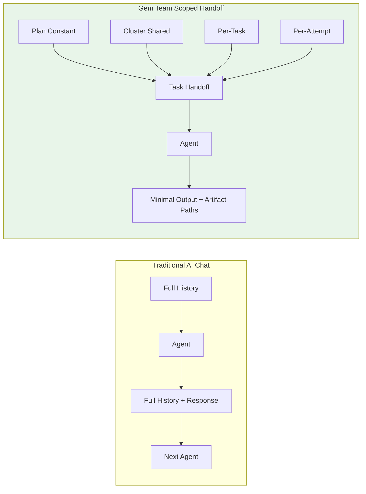

## Cost & Performance by Design

Every architectural decision optimizes for **token efficiency** and **execution speed**.

---

## Model Routing (Configurable)

Two tiers match model strength to task complexity:

| Tier | Agents | Purpose | Recommended Models |
|------|--------|---------|-------------------|
| **Premium** | Planner, Debugger, Reviewer | Reasoning-heavy: planning, diagnosis, challenge, verification | `gpt-5.6-sol`, `claude-4`, `gemini-2.5-pro` |
| **Explore** | Researcher, Implementer, Browser Tester, Mobile Tester, DevOps, Documentation, Skill Creator, Code Simplifier | Fast exploration & bounded execution | `gpt-5.6-luna`, `claude-3.5-haiku`, `gemini-2.5-flash` |

```yaml
# .gem-team.yaml
model_routing:
  enabled: true
  tiers:
    premium: "gpt-5.6-sol (openai)"
    explore: "gpt-5.6-luna (openai)"
```

> **Orchestrator not routed** — Uses session default model. Enable in config to activate. This is the single biggest cost optimization for multi-agent workflows.

---

## Scoped Handoffs (The 80% Token Reduction)

Each agent receives **only what it needs** — not full history.



### Handoff Structure (Cache-Lifetime Order)

```yaml
# Plan-constant (same for ALL tasks in plan)
plan_id: "20250115-user-search-api"
config_snapshot: { ... }

# Cluster-shared (same for tasks in same context_cluster)
context_cluster: "api-search"
shared_context: "REST patterns...; Pagination: src/utils/pagination.ts"

# Per-task (differs per task)
task_id: "implement-search"
task_definition:
  objective: "Implement GET /api/users/search"
  acceptance_criteria: [...]
  handoff:
    constraints: [...]
    relevant_context:
      - "research-api-patterns: patterns=REST, pagination=src/utils/pagination.ts"

# Per-attempt (only on retry)
retries_used: 1
```

**Result**: ~80% token reduction vs full history re-send.

---

## Cache Optimization

LLM providers cache **exact prompt prefixes**. Gem Team maximizes hits:

| Technique | How It Works |
|-----------|--------------|
| **Stable system prompts** | Agent definitions don't change between tasks |
| **Consistent handoff shape** | `task_definition` structure identical across waves |
| **Cache-lifetime field order** | Retries diverge only in payload tail |
| **Cluster-contiguous scheduling** | Shared-context tasks run back-to-back |
| **Minimal churn** | Only new evidence appends; previous waves referenced |

### Observed Cache Performance (DeepSeek V4.1 Flash)

| Metric | Value |
|--------|-------|
| Tokens processed | 82.8M+ across 666 runs |
| Avg context/run | ~124K tokens |
| Typical API call | Sub-$0.001 (100K+ input, mostly cached) |
| Typical latency | 2-5s for 100K-190K input |

### Cost at Scale

| Cache State | Cost per 150K Call |
|-------------|---------------------|
| 100% miss | $0.0225 |
| 95% cached | ~$0.00153 |
| 99% cached | ~$0.00067 |
| 100% hit | $0.00045 |

**30x cost difference** between miss and hit — that's what makes sub-penny runs possible.

---

## Evidence by Reference

**Logs, traces, screenshots, reports stay in task artifacts** — handoffs return paths.

```yaml
# Agent output (minimal)
status: "completed"
handoff:
  implemented_files:
    - "src/api/users/search.ts"
  test_results_path: "wave-3/implement-search/artifacts/test-results.xml"
  api_contract_path: "wave-3/implement-search/artifacts/api-contract.json"
```

**Exception**: `shared_context` findings (consumed by ≥2 tasks) inlined once per cluster.

---

## Proportional Architecture (YAGNI/KISS)

| Decision | Principle |
|----------|-----------|
| Agent set | Smallest that satisfies criteria |
| Wave sequence | Minimum ordered barriers |
| Validation path | Least review that covers risk |
| Context | Bounded to objective |

**Fewer agents = less context multiplied** = lower cost, faster execution.

---

## Conditional Learning

Only **stable, reusable, high-confidence** findings promoted:

| Promotion Criteria | Threshold |
|-------------------|-----------|
| Final success | All waves complete |
| Confidence | ≥ 0.95 |
| Stability | `stable: true` (not task-specific) |
| Reusability | Applies beyond this task |
| Non-duplication | Not already in memory |

**30-day TTL** prevents stale accumulation.

---

## Quick Wins Checklist

- [ ] Enable `model_routing.enabled: true` in `.gem-team.yaml`
- [ ] Use project-scoped installs (commit `apm.lock.yaml`)
- [ ] Pin versions for reproducible cache (`gem-team-v<version>`)
- [ ] Write specific acceptance criteria (enables fast path)
- [ ] Avoid `discuss` intent for executable work (triggers full plan)
- [ ] Reuse plan IDs for continued work (preserves cache)

---

## Related Pages

- [Model Routing Config](/configuration/model-routing) — Tier configuration
- [Workflow: Execute](/guide/workflow-execute) — Where handoffs are constructed
- [Core Concepts](/getting-started/concepts) — Memory tiers and handoffs
- [Optimizations](/guide/optimizations) — Deep dive on cost principles