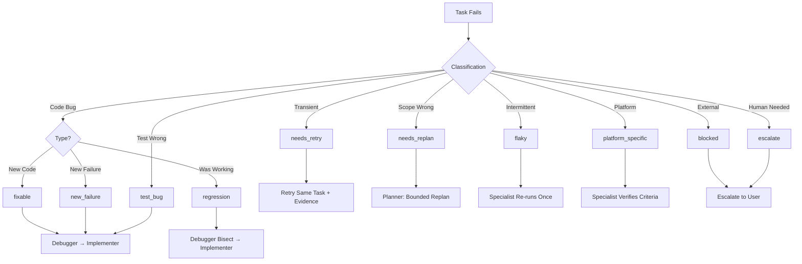

## Philosophy

**Every failure gets a specific classification** that determines the exact handler. No generic "retry" — each classification routes to the right specialist with the right evidence.

---

## Classification Taxonomy

| Classification | Trigger | Handler | Max Retries |
|----------------|---------|---------|-------------|
| `needs_retry` | Transient (network, flaky test, rate limit) | Same task, same scope + evidence | 3 |
| `fixable` | Code bug in implementation | Debugger → Implementer | — |
| `regression` | Previously working, now broken | Debugger (bisect) → Implementer | — |
| `new_failure` | New code, new failure | Debugger → Implementer | — |
| `needs_replan` | Scope wrong, deps missed, architecture change | Planner (bounded replan) | 2 replans |
| `flaky` | Intermittent, non-deterministic | Owning specialist re-runs once | 1 re-run |
| `platform_specific` | Works on one platform, fails on another | Specialist verifies criteria | — |
| `test_bug` | Test itself is defective | Debugger → Implementer | — |
| `blocked` | External dependency unavailable | Stop path, escalate | — |
| `escalate` | Needs human decision | Stop, escalate to user | — |

---

## Classification Flow



---

## Handler Details

### `needs_retry` — Transient Failures
**Triggers**: Network timeout, rate limit, flaky external service, temporary resource exhaustion

**Handler**: Orchestrator retries **same task, unchanged scope**, with failure evidence attached.

```yaml
# Retry payload adds:
retries_used: 1  # Incremented first
task_definition:
  handoff:
    relevant_context:
      - "previous_attempt: error=ECONNREFUSED, attempt=1"
      - "previous_attempt: timestamp=2025-01-15T10:30:00Z"
```

**Max 3 retries**. If all fail → re-classify as `fixable` or `needs_replan`.

---

### `fixable` / `regression` / `new_failure` — Code Bugs

**Route**: Debugger → Implementer (always in sequence)

#### Debugger (`gem-debugger`)
```yaml
# Receives:
failure: "TypeError: Cannot read property 'email' of undefined"
expected_behavior: "User object returned with email field"
evidence:
  - "Stack trace: src/api/users/search.ts:45"
  - "Test: tests/api/users/search.test.ts:23"
  - "Recent change: user model made email optional"
```

**Output**: Root cause + minimal reproduction test + fix recommendation

#### Implementer (`gem-implementer`)
```yaml
# Receives debugger handoff:
handoff:
  debugger_diagnosis:
    root_cause: "User model email field made optional but search assumes required"
    fix_recommendations:
      - "Add null check before accessing user.email"
      - "Update Zod schema to match model"
    reproduction_test: "tests/debug/reproduction-user-email.test.ts"
```

**Implements fix**, verifies with reproduction test + original test suite.

---

### `needs_replan` — Scope/Architecture Issues

**Triggers**: Missing dependencies, wrong task boundaries, architecture decision needed, contract changes discovered

**Handler**: Planner with **bounded replan**

**Replan Input**:
```yaml
baseline: { plan_id, objective, acceptance_criteria }  # Immutable
current_plan: { ... }  # Exact current plan
review_findings: [     # If triggered by review
  { finding: "API contract changed", severity: "high", task: "implement-search" }
]
```

**Replan Constraints**:
- Immutable baseline (objective + criteria never change)
- Max 2 replans (default)
- Must show measurable progress
- Records reason, task changes, preserved criteria, new risks
- Empty/repetitive → escalate

---

### `flaky` — Intermittent Failures

**Handler**: Owning specialist re-runs **once** with same scope.

**Outcome**:
- All pass → Continue (record flaky evidence)
- Any fail → Block, escalate

**Evidence recorded**:
```yaml
flaky_evidence:
  task_id: "browser-test-login"
  attempt_1: "passed"
  attempt_2: "failed: timeout waiting for selector"
  attempt_3: "passed"
  classification: "flaky"
  action: "continue_with_warning"
```

---

### `platform_specific` — Platform Differences

**Handler**: Owning specialist verifies affected criteria on target platform.

**Example**: Test passes on Linux, fails on macOS due to path separator.

```yaml
platform_evidence:
  task_id: "file-path-test"
  platform: "darwin"
  criteria_affected: ["cross-platform path handling"]
  verification: "specialist_verified_criteria_on_darwin"
  outcome: "criteria_met_on_target_platform"
```

---

### `test_bug` — Defective Tests

**Handler**: Debugger diagnoses test → Implementer fixes test.

**Common patterns**:
- Test assumes wrong initial state
- Test uses flaky timing assertions
- Test mocks incorrectly
- Test validates implementation detail, not behavior

---

### `blocked` / `escalate` — Human Required

**Blocked**: External dependency (API down, approval pending, infrastructure not ready)

**Escalate**: Architectural decision, security approval, budget, team decision

**Both**: Stop current path, preserve state, notify user with:
- What's blocked
- Why
- What's needed to unblock
- Estimated wait time (if known)

---

## Replan Guardrails (Details)

| Guardrail | Enforcement |
|-----------|-------------|
| **Immutable baseline** | Objective + acceptance criteria stored separately, never modified |
| **Max 2 replans** | Counter in `plan.yaml`; 3rd attempt → escalate |
| **Lineage** | `revision` number, `replan_count`, `replan_reason` per revision |
| **Measurable progress** | Must complete ≥1 new task or resolve ≥1 blocker |
| **No scope creep** | New tasks only for discovered dependencies, not new features |
| **Empty replan escalation** | If replan produces no task changes → escalate |

---

## Failure Evidence Standards

Every failure includes structured evidence:

```yaml
failure_evidence:
  classification: "fixable"
  task_id: "implement-search"
  agent: "gem-implementer"
  timestamp: "2025-01-15T10:35:00Z"
  error:
    type: "TypeError"
    message: "Cannot read property 'email' of undefined"
    stack: "src/api/users/search.ts:45:12"
  context:
    recent_changes:
      - "src/models/user.ts: email field made optional"
    test_failure: "tests/api/users/search.test.ts:23"
  environment:
    node_version: "26.0.0"
    os: "linux"
```

**Stored in**: `docs/plan/{plan_id}/wave-{n}/{task_id}/artifacts/failure-evidence.yaml`

---

## Quick Reference: What to Do When...

| You See | Action |
|---------|--------|
| "Task failed, retrying..." | Wait — Orchestrator handles `needs_retry` automatically (max 3x) |
| "Debugger analyzing..." | Normal — Debugger finding root cause before fix |
| "Planner replanning..." | Normal — Scope/dependencies adjusted, max 2x |
| "Blocked: waiting for approval" | Provide approval or unblock dependency |
| "Escalated: decision needed" | You must decide — review tradeoffs and respond |
| "Flaky test detected" | Specialist re-running once; if fails again, will block |

---

## Key Rules

1. **No blind retries** — Every retry has classification + evidence
2. **Debugger before Implementer** — Root cause first, then fix
3. **Bounded replans** — Max 2, immutable baseline, measurable progress
4. **Flaky = one re-run** — Not infinite retries
5. **Platform-specific = verify criteria** — Not "works on my machine"
6. **Test bugs = fix test** — Not "disable test"
7. **Blocked/Escalate = human** — Orchestrator stops, preserves state, notifies

---

## Related Pages

- [Phase 3: Execute](/guide/workflow-execute) — Where failures are classified
- [Phase 2: Plan](/guide/plan) — Replan guardrails
- [Debugger Agent](/agents/debugger) — Root cause analysis capabilities
- [First Steps](/getting-started/first-steps) — See failure handling in walkthrough