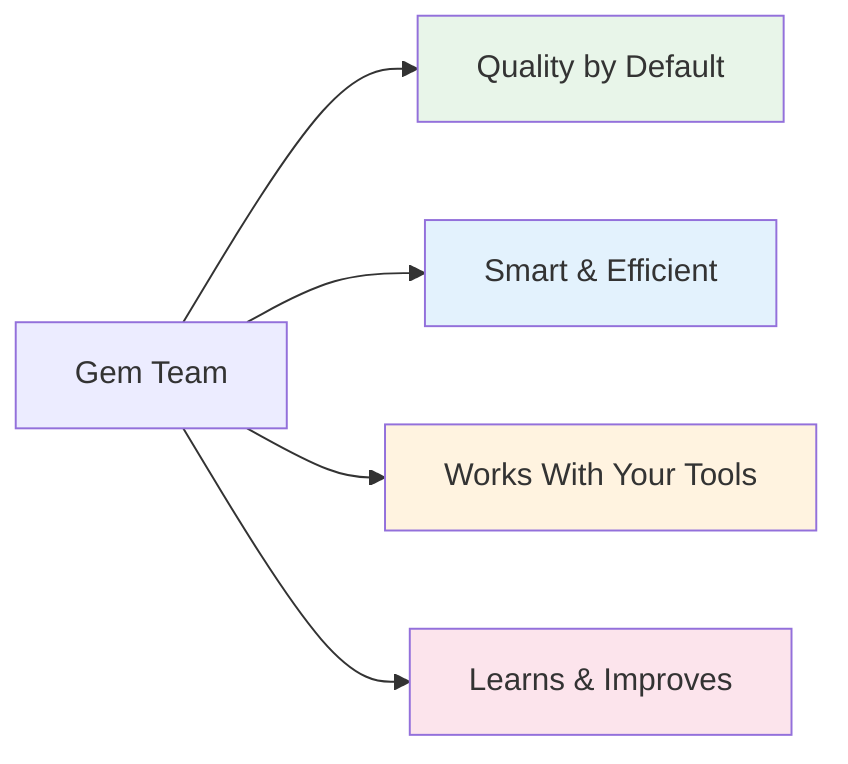

## The Four Pillars

Gem Team is built on four foundational capabilities that transform AI coding from ad-hoc prompting into an engineering process.

---

## Pillar Overview

| Pillar | Core Promise | Key Mechanisms |
|--------|--------------|----------------|
| **[Quality by Default](/guide/quality)** | TDD, reviews, and audits run automatically | Acceptance checks, risk-based review, security/a11y gates |
| **[Smart & Efficient](/guide/efficiency)** | Token cost proportional to new work | Scoped handoffs, cache optimization, model routing |
| **[Works With Your Tools](/guide/compatibility)** | One workflow, any AI coding tool | APM targets, universal agent definitions |
| **[Learns & Improves](/guide/learning)** | Patterns become reusable skills | Memory tiers, confidence gating, skill extraction |

---

## Quality by Default

**Core acceptance checks run automatically** — no configuration needed for basics. Specialist audits route by task requirements and changed-scope risk.

- **Library-first** — Prefer maintained libraries over custom implementations
- **Plan validation** — MEDIUM/HIGH plans validated for ordering, ownership, correctness, contracts
- **Risk-based review** — Standard, high, or critic review for high-risk signals or explicit requests
- **Security & compliance** — Review changed code, config, integrations; route security-sensitive work
- **Accessibility** — Configurable WCAG 2.2 AA checks (contrast, ARIA, focus, touch targets)
- **Visual regression** — Screenshot comparison against configurable threshold
- **Simplification** — Targeted design simplification, answer with action first

[Read Quality Details →](/guide/quality)

---

## Smart & Efficient

**Cost and performance are core design principles** — not afterthoughts.

- **Model routing** — Premium tier for planning/debugging/review; Explore tier for execution
- **Scoped handoffs** — Each agent receives only what it needs (~80% token reduction)
- **Cache optimization** — Stable prefixes, cache-lifetime field ordering, cluster-contiguous scheduling
- **Evidence by reference** — Logs, traces, screenshots in task artifacts; handoffs reference paths
- **Proportional architecture** — YAGNI/KISS: smallest agent set, wave sequence, validation path
- **Conditional learning** — Only stable, reusable findings promoted (confidence ≥ 0.95)

[Read Efficiency Details →](/guide/efficiency)

---

## Works With Your Tools

**One workflow, multiple AI coding tools** — install once, use everywhere.

| Target | Tool / Harness | Output Location |
|--------|----------------|-----------------|
| `copilot` | VS Code Copilot / GitHub Copilot CLI | `.github/agents/`, `.github/instructions/`, `.github/prompts/` |
| `claude` | Claude Code | `.claude/agents/`, `.claude/rules/`, commands, skills, hooks |
| `cursor` | Cursor | `.cursor/agents/`, `.cursor/rules/`, skills, commands, hooks |
| `opencode` | OpenCode | `.opencode/agents/`, commands, skills |
| `codex` | Codex CLI | `.codex/agents/`, `AGENTS.md`, Codex config |
| `gemini` | Gemini CLI | `GEMINI.md`, skills/instructions, config |
| `windsurf` | Windsurf / Cascade | `.windsurf/rules/`, skills, commands, hooks |

> APM compiles or skips unsupported primitives for each target.

[Read Compatibility Details →](/guide/compatibility)

---

## Learns & Improves

**Every successful task makes the next one faster** through structured learning.

- **Three-tier memory** — Repo (workspace), Session (conversation), Global (user)
- **Confidence gating** — Only findings ≥ 0.95 confidence promoted after success
- **Skill extraction** — Reusable workflows packaged as `SKILL.md` playbooks
- **Stable cache** — Structured handoffs maximize provider cache hit rates
- **Batch optimization** — Related work coalesced to share context

[Read Learning Details →](/guide/learning)

---

## Quick Start by Pillar

| If You Want... | Start Here |
|----------------|------------|
| Automatic quality gates | [Quality →](/guide/quality) |
| Lower token costs | [Efficiency →](/guide/efficiency) |
| Use with your current tool | [Compatibility →](/guide/compatibility) |
| Build reusable knowledge | [Learning →](/guide/learning) |

---

## Related Pages

- [Core Concepts](/getting-started/concepts) — Mental model behind the pillars
- [Workflow](/guide/workflow) — How pillars execute in phases
- [Agents](/agents) — Specialists that deliver each pillar
- [Optimizations](/guide/optimizations) — Deep dive on efficiency principles