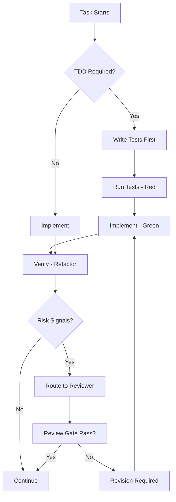

---

title: Quality by Default
description: Automatic TDD, risk-based reviews, security audits, and accessibility checks.
navigation:
  icon: i-lucide-shield-check
seo:
  title: Quality by Default — Gem Team
  description: Automatic TDD, risk-based reviews, security audits, and accessibility checks built into every task.
  ogTitle: Quality by Default — Gem Team
  ogDescription: Automatic TDD, risk-based reviews, security audits, and accessibility checks.
---


## Automatic Quality Gates

Quality isn't optional — it's built into every task execution.



---

## TDD by Default

Every implementation task follows **Red-Green-Refactor**:

| Phase | Action | Verification |
|-------|--------|--------------|
| **Red** | Write failing test first | Test fails as expected |
| **Green** | Minimal implementation | Test passes |
| **Refactor** | Clean up, optimize | All tests still pass |

**Six test dimensions** validated:
1. **Correctness** — Expected behavior
2. **Contracts** — API schemas, types
3. **Edge cases** — Boundaries, errors, empty states
4. **Performance** — Latency, memory, bundle size
5. **Security** — Input validation, auth, injection
6. **Accessibility** — WCAG 2.2 AA (when UI involved)

> **TDD is mandatory** — No implementation without a failing test first. The Implementer agent enforces this for every code task.

---

## Risk-Based Review

Not all code needs the same review intensity. Review routes by **risk signals**:

| Review Mode | When Triggered | Intensity |
|-------------|----------------|-----------|
| **Standard** | Routine MEDIUM, explicit request | Changed files, criteria check |
| **High** | HIGH complexity, high-risk signals | Affected files, deep analysis |
| **Critic** | Architecture decisions, `architecture`/`breaking_change`/`cross_domain_impact` | Full scope, read-only, challenges assumptions |

### Risk Signals That Trigger Review

```yaml
# Architecture signals
architecture: true
contract_change: true
breaking_change: true
api_change: true
schema_change: true

# Security signals
auth_change: true
security_sensitive: true
data_flow_change: true

# Irreversible signals
migration: true
irreversible: true
shared_state: true

# Cross-domain
cross_domain_impact: true
```

> **Critic mode is read-only** — Evaluates assumptions, counterexamples, risks, alternatives, reversibility. Does not implement or mutate files. There is no standalone `gem-critic` agent.

---

## Security & Compliance

Security review runs automatically for:

| Trigger | Review Focus |
|---------|--------------|
| `auth_change` | Authentication/authorization logic |
| `security_sensitive` | Crypto, secrets, PII handling |
| `data_flow_change` | Data movement, storage, transmission |
| Config changes | Infrastructure, permissions, network |
| Dependency updates | Supply chain, vulnerabilities |

**Security findings block** until resolved — no "accept risk" in automated flow.

---

## Accessibility (Configurable)

```yaml
# .gem-team.yaml
quality:
  a11y_audit_level: basic  # none | basic | full
```

| Level | Checks |
|-------|--------|
| `none` | No a11y checks |
| `basic` | Contrast (4.5:1), ARIA labels, focus indicators, touch targets (44pt/48dp) |
| `full` | All basic + reduced motion, semantic HTML, screen reader testing, keyboard navigation |

---

## Visual Regression

```yaml
# .gem-team.yaml
quality:
  visual_regression_enabled: true
  visual_diff_threshold: 0.95  # 0.0 - 1.0
```

- Captures screenshots on UI changes
- Compares against baseline (stored in task artifacts)
- Fails if difference > threshold
- Configurable per-task via acceptance criteria

---

## Simplification & Clarity

Applied automatically during implementation and review:

- **YAGNI/KISS** — Smallest architecture that satisfies criteria
- **Action-first answers** — Lead with what to do, not explanation
- **Dead button detection** — UI elements with no handlers flagged
- **External script patches** — Blocking issue (security risk)
- **AI-slop comment removal** — No "this function does X" comments

---

## Quality Configuration

```yaml
# .gem-team.yaml
quality:
  visual_regression_enabled: false
  visual_diff_threshold: 0.95
  a11y_audit_level: none  # none | basic | full
```

**Task criteria and explicit requests take precedence** over config defaults.

---

## Example: Quality in Action

**Task**: "Add payment processing endpoint"

| Phase | Quality Action |
|-------|----------------|
| **Plan** | Risk signals: `security_sensitive`, `data_flow_change` → HIGH review |
| **Implement** | Tests first: success, decline, invalid card, webhook validation |
| **Review** | Critic mode: PCI compliance, idempotency, logging, error handling |
| **Verify** | Browser tester: payment flow E2E, visual regression on checkout |
| **Output** | Security findings promoted to repo memory (confidence 0.98) |

---

## Key Rules

1. **TDD always** — No implementation without test first
2. **Risk drives review** — Signals automatically route to correct intensity
3. **Security blocks** — No automated risk acceptance
4. **Configurable depth** — a11y and visual regression via config
5. **Simplification built-in** — Not a separate step, part of implementation
6. **Wave-level gates** — Post-wave quality gate after each wave; final plan-wide review gate before Phase 4 output (MEDIUM/HIGH or any high-risk signal)

---

## Quality Anti-Patterns

| Anti-Pattern | Why It Fails | Correct Approach |
|--------------|-------------|------------------|
| Skipping tests to move faster | Bugs surface later, cost more to fix | TDD: test first, always |
| Reviewer bypassed for "simple" changes | Security/a11y gaps missed | Risk signals drive review automatically |
| Accepting security risk in automated flow | Vulnerabilities ship to production | Security findings block until resolved |
| Testing implementation, not behavior | Refactors break tests unnecessarily | Test behavior, assert outcomes |
| Visual regression threshold too strict | False positives on dynamic content | Set threshold per-content type (0.99 design, 0.90 dynamic) |
| a11y level `none` on user-facing UI | Excludes users with disabilities | Use `basic` minimum for UI work |

---

## Related Pages

- [Workflow: Execute](/guide/workflow-execute) — Where quality gates run
- [Reviewer Agent](/agents/reviewer) — Review modes and targets
- [Configuration](/configuration) — Quality settings
- [First Steps](/getting-started/first-steps) — Quality in walkthrough