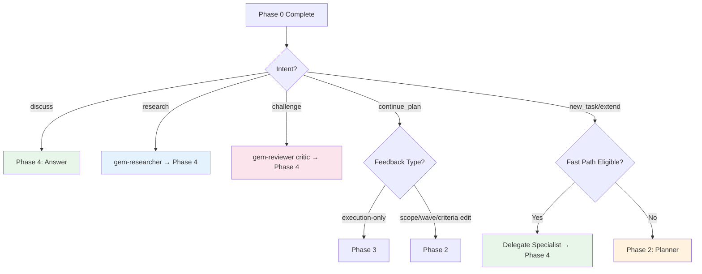

---

title: Phase 1 — Route
description: Route the classified request to the correct execution path.
navigation:
  icon: i-lucide-git-branch
seo:
  title: Route — Gem Team
  description: "Phase 1: fast path vs full plan routing based on complexity and risk signals."
  ogTitle: Route — Gem Team
  ogDescription: Phase 1: route requests to fast path or full plan.
---


## Purpose

Determine the execution path based on Phase 0 classification. No work happens here — only routing decisions.

---

## Routing Table

| Request State + Intent | Route To | Notes |
|------------------------|----------|-------|
| `discuss` (any) | **Phase 4** (direct answer) | No plan, no delegation |
| `research` (standalone) | **gem-researcher** → Phase 4 | Read-only, correlation ID only |
| `challenge` | **gem-reviewer** (critic mode) → Phase 4 | Read-only decision review |
| `continue_plan` + execution-only | **Phase 3** | Resume existing plan |
| `continue_plan` + scope/wave/criteria edits | **Phase 2** | Replan with edits |
| `new_task` / valid `extend` | **Phase 2** (or fast path) | See eligibility below |

---

## Fast Path Eligibility

For `new_task` or valid `extend`, the Orchestrator checks **all** criteria:

| Criterion | Check | Why It Matters |
|-----------|-------|----------------|
| **Single owner** | One narrowest specialist completes end-to-end | No coordination overhead |
| **Bounded scope** | One domain/file area | Predictable context |
| **Clear acceptance criteria** | Explicit or trivially inferable | No investigation needed |
| **No high-risk signals** | Zero matches from Phase 0 | No review gates needed |

**If ALL true** → Fast path: delegate directly to specialist, skip Planner & Reviewer.

**If ANY false** → Full plan: Phase 2 (Planner) with persistent `plan.yaml`.

:::tip[FAST PATH = NO PLANNER, NO REVIEWER]
Direct delegation to specialist. Saves 2+ agent calls and review gates.
:::

---

## Fast Path Flow

```
Phase 0 Classification
        │
        ▼
   ┌─────────┐
   │Eligible?│──No──→ Phase 2 (Planner)
   └────┬────┘
        │Yes
        ▼
   Delegate to Specialist
   (Implementer, Debugger, etc.)
        │
        ▼
   Execute + Verify
        │
        ▼
   Phase 4: Output
```

**Fast path still uses a `plan_id`** for correlation, but creates no persistent plan artifacts.

---

## Research Path (Standalone)

```
Phase 0: intent=research
        │
        ▼
gem-researcher (exploration_mode per question)
        │
        ▼
Phase 4: Present findings
        │
        ├── next_action: return_findings → Done
        ├── next_action: plan_follow_up → Promote to Phase 2 (same plan_id)
        └── next_action: needs_input → Ask user questions, stop
```

**No persistent plan created** unless promoted via `plan_follow_up`.

---

## Challenge Path

```
Phase 0: intent=challenge
        │
        ▼
gem-reviewer (review_mode: critic, review_target: decision, review_scope: full)
        │
        ▼
Phase 4: Synthesize critic result + evidence + tradeoffs + decision needed
```

**Critic mode is read-only** — evaluates assumptions, counterexamples, risks, alternatives, reversibility. Does not implement or mutate files.

---

## Continue Plan: Execution vs Revision

| Feedback Type | Route | Example |
|---------------|-------|---------|
| "Continue" / "Resume" | Phase 3 | "Continue plan 20261121-xyz" |
| "Add new task" | Phase 2 (`extend`) | "Extend plan 20261121-xyz with new feature" |
| "Change wave order" | Phase 2 (`revise_waves`) | "Move review before implementation" |
| "Update criteria" | Phase 2 (`revise_criteria`) | "Add performance benchmark requirement" |
| "Change scope" | Phase 2 (`revise_scope`) | "Also update the mobile API" |

**Ambiguous input** → Ask once for classification.

---

## Missing/Invalid Plan ID

| Scenario | Action |
|----------|--------|
| `continue_plan` without `plan_id` | Block, request exact ID |
| `plan_id` not found | Block, request exact ID |
| `plan_id` format invalid | Block, request valid format (`^[a-z0-9-]+$`) |

**Never infers, fuzzy-matches, or auto-loads plan IDs.**

:::warning[EXACT PLAN ID REQUIRED]
No fuzzy matching, no inference. Continuation requires the exact `plan_id` from the original execution.
:::

---

## Promotion: Fast Path → Persistent Plan

Fast path work **auto-promotes** when continued execution needs:
- Dependencies on other tasks
- Shared state across tasks
- Contract/risk changes
- Durable evidence for reuse

**On promotion:**
1. Keep same `plan_id`
2. Create `docs/plan/{plan_id}/plan.yaml`
3. Preserve context, evidence, task owner, wave placement
4. Keep completed work in position
5. Route new scope through Planner
6. Reuse non-stale completed work

---

## Quick Decision Flowchart



---

## Routing Examples

| Scenario | Intent | Complexity | Route | Reason |
|----------|--------|------------|-------|--------|
| Fix typo in README | execute | TRIVIAL | Fast path | Single owner, bounded scope |
| Extract validation helper | execute | LOW | Fast path | Single domain, clear criteria |
| Add /api/users/search | execute | MEDIUM | Phase 2 Planner | Multi-file, risk signals |
| Migrate auth to OAuth2 | execute | HIGH | Phase 2 Planner + Reviewer | High-risk, breaking change |
| "How does caching work?" | research | LOW | gem-researcher → Phase 4 | Standalone research |
| "Should we use Redis or DB?" | challenge | MEDIUM | gem-reviewer critic → Phase 4 | Decision review |
| "Continue plan 20261121-xyz" | continue_plan | MEDIUM | Phase 3 | Resume existing plan |

## Continue Plan: Decision Table

| Feedback Type | Route | Example |
|---------------|-------|---------|
| "Continue" / "Resume" | Phase 3 | "Continue plan 20261121-xyz" |
| "Add new task" | Phase 2 (`extend`) | "Extend plan 20261121-xyz with new feature" |
| "Change wave order" | Phase 2 (`revise_waves`) | "Move review before implementation" |
| "Update criteria" | Phase 2 (`revise_criteria`) | "Add performance benchmark requirement" |
| "Change scope" | Phase 2 (`revise_scope`) | "Also update the mobile API" |

**Ambiguous input** → Ask once for classification.

---

## Key Rules

1. **No work in Phase 1** — Pure routing
2. **Fast path = no Planner, no Reviewer** — Direct to specialist
3. **Research = read-only** — No plan unless promoted
4. **Challenge = critic review** — Read-only, decision-focused
5. **Continue plan = exact ID required** — No inference
6. **Promotion preserves everything** — No lost context

---

## Next Phase

→ [Phase 2: Plan](/guide/plan) — Wave planning, task coalescing, review gates