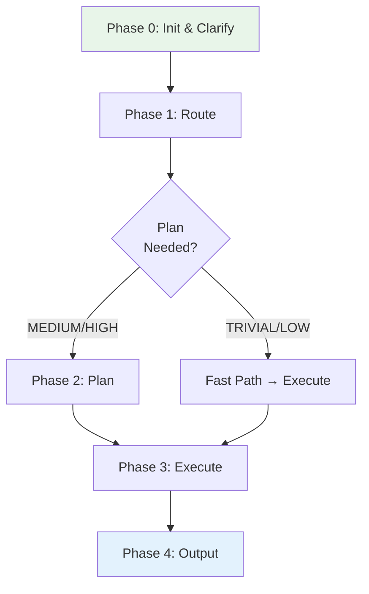
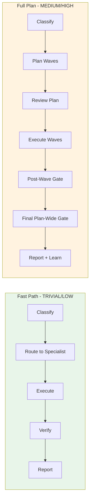

---

title: Workflow
description: How Gem Team turns AI coding into a structured, reliable engineering process.
navigation:
  icon: i-lucide-workflow
seo:
  title: Workflow — Gem Team
  description: How Gem Team turns AI coding into a structured, reliable engineering process through five phases.
  ogTitle: Workflow — Gem Team
  ogDescription: How Gem Team turns AI coding into a structured engineering process.
---

## The Five-Phase Pipeline

Every task follows this structured pipeline — no exceptions, no shortcuts.

---

## Phase Overview

| Phase | Name | Purpose | Duration |
|-------|------|---------|----------|
| **0** | [Init & Clarify](/guide/init-clarify) | Classify request, assess risk, assign complexity | Instant |
| **1** | [Route](/guide/route) | Send to fast path or planning | Instant |
| **2** | [Plan](/guide/plan) | Build wave plan with handoffs (MEDIUM/HIGH) | 10-60s |
| **3** | [Execute](/guide/workflow-execute) | Run waves, delegate specialists, verify | Variable |
| **4** | [Output](/guide/workflow-output) | Structured report + learnings | Instant |

---

## Key Principles

### 1. Orchestrator Coordinates, Specialists Execute
The Orchestrator **never writes code**. It classifies, plans, delegates, tracks state, and enforces gates. All implementation, debugging, testing, and research are delegated to specialist agents.

### 2. Complexity Drives Process Depth
| Complexity | Planning | Review | Persistence | Use Case |
|------------|----------|--------|-------------|----------|
| **TRIVIAL** | None | None | Correlation ID | One-file bug fix |
| **LOW** | In-memory | None | Correlation ID | Small refactor |
| **MEDIUM** | Persistent `plan.yaml` | If risky | Full artifacts | Multi-file feature |
| **HIGH** | Persistent `plan.yaml` | Required | Full artifacts | Architecture changes |

### 3. Waves Provide Ordered Barriers
- Each wave **completes fully** before the next starts
- Within a wave, independent tasks run **in parallel** (up to `max_concurrent_agents`)
- Evidence flows forward via **scoped handoffs** — not full context

### 4. Failures Are Classified, Not Retried Blindly
Every failure gets a specific classification that routes to the correct handler:
- `needs_retry` → Retry same task (max 3x)
- `fixable` / `regression` → Debugger → Implementer
- `needs_replan` → Planner (bounded replan)
- `blocked` / `escalate` → Stop, escalate to user

### 5. Learning Happens After Success
Only findings with **confidence ≥ 0.95** after final success are promoted to repo memory. This prevents polluting the knowledge base with speculative or incorrect patterns.

---

## Fast Path vs Full Plan

**Fast Path eligibility (all required):**
- Single owner: one specialist completes end-to-end
- Bounded scope: one domain/file area
- Clear acceptance criteria
- No high-risk signals

---

## Plan Identity & Resumability

- **Every task gets a `plan_id`** (format: `YYYYMMDD-slug`)
- **TRIVIAL/LOW**: ID used for correlation only
- **MEDIUM/HIGH**: Persistent `docs/plan/{plan_id}/plan.yaml` with full state
- **Resumption requires exact `plan_id`** — no fuzzy matching
- **Continue/extend** preserves completed waves, adds new ones

---

## Concrete Workflow Example: User Search API (MEDIUM)

| Phase | Agent | Action | Output |
|-------|-------|--------|--------|
| 0: Init & Clarify | Orchestrator | Classify: execute, MEDIUM, risk `api_change` | `plan_id`, complexity, risk signals |
| 1: Route | Orchestrator | Route to Phase 2 (MEDIUM needs planning) | Route decision |
| 2: Plan | gem-planner | Build 3-wave plan, self-check, review gate | `plan.yaml` |
| 3: Execute | Multiple | Wave 1: Researcher; Wave 2: Implementer×2; Wave 3: Reviewer | Task outputs, artifacts |
| 4: Output | Orchestrator | Status report, memory promotion, skill extraction | Structured report |

**Total**: ~5 agent calls, persistent plan artifacts, resumable via `plan_id`.

---

## Quick Reference: When to Use What

| Your Task | Likely Path | Example |
|-----------|-------------|---------|
| Fix typo, one-line bug | Fast Path (TRIVIAL) | "Fix typo in README" |
| Refactor single function | Fast Path (LOW) | "Extract validation helper" |
| Add new API endpoint | Full Plan (MEDIUM) | "Create /api/users/search" |
| Redesign auth system | Full Plan (HIGH) | "Migrate to OAuth2 + JWT" |
| Research question | Research Path | "How does caching work?" |
| Decision review | Challenge Path | "Should we use React or Vue?" |

---

## Next: Deep Dive into Each Phase

  

    <h3>Phase 0: Init & Clarify</h3>
    
Classification, risk assessment, complexity assignment

    <a href="/guide/init-clarify" class="text-primary">Read →</a>
  

  

    <h3>Phase 1: Route</h3>
    
Fast path vs planning, research, challenge paths

    <a href="/guide/route" class="text-primary">Read →</a>
  

  

    <h3>Phase 2: Plan</h3>
    
Wave planning, task coalescing, review gates

    <a href="/guide/plan" class="text-primary">Read →</a>
  

  

    <h3>Phase 3: Execute</h3>
    
Wave loop, delegation, verification, persistence

    <a href="/guide/workflow-execute" class="text-primary">Read →</a>
  

  

    <h3>Phase 4: Output</h3>
    
Status reports, learnings, memory promotion

    <a href="/guide/workflow-output" class="text-primary">Read →</a>
  

  

    <h3>Failure Handling</h3>
    
Classification, routing, replan guardrails

    <a href="/guide/failure-handling" class="text-primary">Read →</a>
  

---

## Related Pages

- [Core Concepts](/getting-started/concepts) — Mental model behind the workflow
- [Agents Catalog](/agents) — Specialist capabilities
- [First Steps Walkthrough](/getting-started/first-steps) — See workflow in action
- [Optimizations](/guide/optimizations) — Cost and performance principles