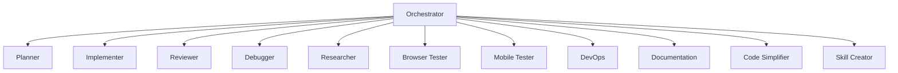

---

title: Agent Team
description: Gem Team specialist agents — concise catalog with agent definition links.
navigation:
  icon: i-lucide-bot
seo:
  title: Agents — Gem Team
  description: Gem Team specialist agents catalog: orchestrator, planner, implementer, reviewer, debugger, researcher, and more.
  ogTitle: Agents — Gem Team
  ogDescription: Gem Team specialist agents catalog.
---

## Architecture

**Hub-and-spoke**: Orchestrator coordinates 11 specialists. Never executes work — only classifies, routes, tracks state.

---

## Agents

| Agent | Role | Delegated When | Typical Output |
|-------|------|----------------|----------------|
| **Orchestrator** | Workflow coordination (Phases 0-4). Classifies, routes, delegates, tracks state, enforces gates. Never writes code. | Every task (entry point) | Status report, route decision, plan_id |
| **Planner** | Builds wave plans for MEDIUM/HIGH work. Task coalescing, self-check, review gating. Never implements. | Multi-task, dependent, or risky work | `plan.yaml` with ordered waves |
| **Implementer** | TDD implementation: Red → Green → Refactor. Writes tests first, minimal implementation, verifies. | Features, fixes, refactors | Implemented files, test files, test results |
| **Reviewer** | Three-axis review (mode/target/scope). Quality, security, contracts, compliance. Critic mode is read-only. | Risk signals, explicit request | Verdict (pass/warning/blocking/needs_revision) |
| **Debugger** | Root cause analysis, reproduction test, regression bisection. Never implements — hands off to Implementer. | `fixable`/`regression`/`new_failure`/`test_bug` | Root cause, fix recommendation, reproduction test |
| **Researcher** | Codebase exploration: 5 modes (scan, deep, audit, trace, question). Budgeted, evidence-based. | Planning context, standalone research | Findings with confidence, shared_context |
| **Browser Tester** | UI/E2E testing: flow assertions, visual regression, a11y, performance, network, contract. | UI features, visual regression | Test results, screenshots, HAR, a11y report |
| **Code Simplifier** | Refactoring: dead code removal, complexity reduction, duplicate consolidation, naming. One-line reason per change. | Explicit refactor, post-impl cleanup | Refactored files, removed files, complexity metrics |
| **DevOps** | Infrastructure, CI/CD, deployments, health checks, rollback, mobile releases. Approval gates enforced. | Infrastructure, releases, pipelines | Deployment info, health checks, smoke tests |
| **Documentation** | Tech docs, API docs, architecture diagrams, PRDs. No buzzwords, runnable examples, diagrams as code. | Docs creation, PRD updates | Doc files, diagrams, API specs |
| **Mobile Tester** | iOS/Android E2E with Detox, Maestro, Appium. Platform-specific behavior checks. | Mobile features, release validation | Test results, screenshots, device logs |
| **Skill Creator** | Packages proven patterns into `SKILL.md` playbooks. Confidence ≥ 0.95, used ≥ 2 times. | ≥2 uses, confidence ≥ 0.95 | SKILL.md, scripts, references, assets |

---

## When to Delegate Each Agent (Quick Guide)

| Your Need | Delegate To | Why |
|-----------|-------------|-----|
| Plan a multi-file feature | **Planner** | Ordered waves, task coalescing, self-check |
| Implement a feature (TDD) | **Implementer** | Tests first, minimal diff, verification |
| Fix a bug | **Debugger** → **Implementer** | Root cause first, then fix |
| Review code/security/contracts | **Reviewer** | Three-axis review, critic mode for architecture |
| Explore codebase patterns | **Researcher** | Budgeted modes, evidence-based findings |
| Test a UI flow | **Browser Tester** | Visual regression, a11y, performance, contract |
| Refactor / simplify code | **Code Simplifier** | Dead code, complexity, duplicates, naming |
| Deploy infrastructure | **DevOps** | CI/CD, health checks, rollback, approval gates |
| Write docs / PRD | **Documentation** | API docs, diagrams, runnable examples |
| Test mobile app | **Mobile Tester** | Detox, Maestro, Appium on iOS/Android |
| Extract reusable pattern | **Skill Creator** | Packages SKILL.md from proven workflows |

---

## Reviewer: Three Axes

| Axis | Values |
|------|--------|
| **review_mode** | `standard` \| `high` \| `critic` (read-only) |
| **review_target** | `plan` \| `task` \| `code` \| `decision` \| `docs` \| `config` \| `integration` |
| **review_scope** | `changed` \| `affected` \| `full` |

[Reviewer Routing Details](/agents/reviewer-routing)

---

## Model Routing (Optional)

| Tier | Agents | Purpose |
|------|--------|---------|
| **Premium** | Planner, Debugger, Reviewer | Reasoning: planning, diagnosis, challenge |
| **Explore** | Researcher, Implementer, Testers, DevOps, Docs, Skill Creator, Code Simplifier | Fast execution & exploration |

Enable in `.gem-team.yaml`. [Model Routing Details](/agents/model-routing)

---

## Packaged Skills

| Skill | Purpose | Activation | Source |
|-------|---------|------------|--------|
| `gem-devops-guidelines` | Deployment, CI/CD, health checks, rollback | DevOps, pipeline, release tasks | [`.apm/skills/gem-devops-guidelines/SKILL.md`](/.apm/skills/gem-devops-guidelines/SKILL.md) |

[Skills Details](/agents/skills)

---

## Related

- [Workflow](/guide/workflow) — Phase 0-4 execution
- [Core Concepts](/getting-started/concepts) — Handoffs, memory, waves
- [Configuration](/configuration) — Model routing, quality settings
- [First Steps](/getting-started/first-steps) — Agents in action