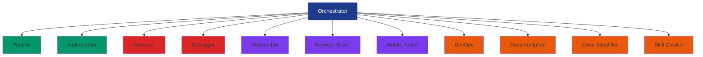

## Agent Architecture

Gem Team uses a **hub-and-spoke** model: one Orchestrator coordinates multiple specialist agents.



---

## Agent Categories

| Category | Agents | Purpose |
|----------|--------|---------|
| **Orchestrator** | Orchestrator | Coordinates workflow, delegates, tracks state |
| **Core** | Planner, Implementer, Researcher | Planning, execution, exploration |
| **Quality & Review** | Reviewer, Debugger, Browser Tester, Code Simplifier | Verification, debugging, testing, refactoring |
| **Specialized** | DevOps, Documentation, Mobile Tester, Skill Creator | Infrastructure, docs, mobile, skill packaging |

---

## Quick Reference

| Agent | Primary Role | When Delegated |
|-------|--------------|----------------|
| **Orchestrator** | Workflow coordination | Every task (entry point) |
| **Planner** | Wave planning | MEDIUM/HIGH complexity |
| **Implementer** | TDD implementation | Features, fixes, refactors |
| **Reviewer** | Quality/security review | Risk-triggered, explicit request |
| **Debugger** | Root cause analysis | Bug fixes, test failures |
| **Researcher** | Codebase exploration | Planning context, standalone research |
| **Browser Tester** | UI/E2E testing | Visual, a11y, contract testing |
| **Code Simplifier** | Refactoring | Dead code, complexity, duplicates |
| **DevOps** | Infrastructure/CI/CD | Deploy, pipeline, health checks |
| **Documentation** | Tech docs, API docs, diagrams | Docs creation, PRD updates |
| **Mobile Tester** | Mobile E2E | iOS/Android testing |
| **Skill Creator** | Skill packaging | Reusable pattern extraction |

---

## Orchestrator

**The coordinator — never executes specialist work.**

| Responsibility | Details |
|----------------|---------|
| **Phase 0-4 workflow** | Init → Route → Plan → Execute → Output |
| **Classification** | Intent, complexity, risk from supplied evidence only |
| **Delegation** | Sends tasks to narrowest specialist with scoped handoff |
| **State tracking** | Plan status, wave progress, retry counts |
| **Verification gates** | Invokes Reviewer only when triggered |
| **Failure classification** | Routes each failure to correct handler |
| **Memory promotion** | Promotes stable findings after success |
| **Relational invariant fallbacks** | Infers intent when agent output misses conditional fields |

[Read Orchestrator Details →](/agents/orchestrator)

---

## Core Agents

| Agent | Description |
|-------|-------------|
| **[Planner](/agents/planner)** | Validates baseline, builds minimal wave plan with ordered waves, routing, handoffs, risks. Persists `plan.yaml`, applies YAGNI/KISS, coalesces tasks. |
| **[Implementer](/agents/implementer)** | Implements features, fixes, refactors with TDD. Bug fixes require diagnosis first. Prefers shortest correct diff. Every decision has one-line reason. |
| **[Researcher](/agents/researcher)** | Explores patterns, dependencies, architecture in 5 budgeted modes: scan, deep, audit, trace, question. Runs directly or under Planner budget. |

---

## Quality & Review Agents

| Agent | Description |
|-------|-------------|
| **[Reviewer](/agents/reviewer)** | Reviews plans, code, decisions for quality, security, contracts, compliance. Three axes: mode (standard/high/critic), target, scope. Over-engineering pass for code/integration. |
| **[Debugger](/agents/debugger)** | Reproduces failures, finds root causes, bisects regressions. Adds minimal reproduction test before recommending fix; never implements. |
| **[Browser Tester](/agents/browser-tester)** | Checks browser/UI flows with conditional visual, a11y, performance, network, regression testing. |
| **[Code Simplifier](/agents/code-simplifier)** | Removes dead code, reduces complexity, consolidates duplicates, improves naming. Every refactoring has one-line reason. No buzzwords. |

---

## Specialized Agents

| Agent | Description |
|-------|-------------|
| **[DevOps](/agents/devops)** | Infrastructure, CI/CD, containers, production approvals, health checks, rollback strategies. Idempotent operations. |
| **[Documentation](/agents/documentation)** | Technical docs, READMEs, API docs, diagrams, walkthroughs, PRD updates. No buzzwords, no fabricated statistics. |
| **[Mobile Tester](/agents/mobile-tester)** | Scope-selected mobile E2E with Detox, Maestro, Appium, or e2e. Safe areas, keyboards, permissions, dark mode, haptics. |
| **[Skill Creator](/agents/skill-creator)** | Extracts high-confidence patterns into reusable `SKILL.md`, scripts, references, assets. |

---

## Reviewer Routing (Three Axes)

The Reviewer uses **three independent axes** for precise review targeting:

| Axis | Values | Purpose |
|------|--------|---------|
| **review_mode** | `standard` \| `high` \| `critic` | Review intensity |
| **review_target** | `plan` \| `task` \| `code` \| `decision` \| `docs` \| `config` \| `integration` | What to review |
| **review_scope** | `changed` \| `affected` \| `full` | How much evidence to examine |

**Critic mode is read-only** — evaluates assumptions, counterexamples, risks, alternatives, reversibility. Does not implement or mutate files.

[Read Reviewer Routing Details →](/agents/reviewer-routing)

---

## Model Routing (Configurable)

Two tiers match model capability to task demands:

| Tier | Agents | Purpose | Example Models |
|------|--------|---------|----------------|
| **Premium** | Planner, Debugger, Reviewer | Reasoning-heavy: planning, diagnosis, challenge | `gpt-5.6-sol`, `claude-4`, `gemini-2.5-pro` |
| **Explore** | Researcher, Implementer, Browser Tester, Mobile Tester, DevOps, Documentation, Skill Creator, Code Simplifier | Fast exploration & bounded execution | `gpt-5.6-luna`, `claude-3.5-haiku`, `gemini-2.5-flash` |

**Orchestrator not routed** — uses session default. Enable in `.gem-team.yaml`.

[Read Model Routing Details →](/agents/model-routing)

---

## Packaged Skills

Reusable guidance lives separately from agent definitions in `.apm/skills/`:

| Skill | Purpose | Activation Scope | Source |
|-------|---------|------------------|--------|
| `gem-devops-guidelines` | Deployment, CI/CD, containers, health checks, rollback | DevOps, platform, pipeline, release tasks | `.apm/skills/gem-devops-guidelines/SKILL.md` |

Skills are loaded for matching tasks and keep agent definitions focused.

[Read Skills Details →](/agents/skills)

---

## Agent Definitions Location

```
.apm/agents/
├── gem-orchestrator.agent.md
├── gem-planner.agent.md
├── gem-implementer.agent.md
├── gem-reviewer.agent.md
├── gem-debugger.agent.md
├── gem-researcher.agent.md
├── gem-browser-tester.agent.md
├── gem-code-simplifier.agent.md
├── gem-devops.agent.md
├── gem-documentation-writer.agent.md
├── gem-mobile-tester.agent.md
└── gem-skill-creator.agent.md
```

All definitions use valid YAML contracts and consolidated output fields for cross-model compatibility.

---

## Next: Deep Dive into Each Agent

<div class="grid grid-cols-1 md:grid-cols-2 lg:grid-cols-3 gap-4">
  <div class="p-4 border rounded-lg">
    <h3>Orchestrator</h3>
    <p>Workflow coordination, delegation, state tracking</p>
    <a href="/agents/orchestrator" class="text-primary">Read →</a>
  </div>
  <div class="p-4 border rounded-lg">
    <h3>Planner</h3>
    <p>Wave planning, task coalescing, self-check</p>
    <a href="/agents/planner" class="text-primary">Read →</a>
  </div>
  <div class="p-4 border rounded-lg">
    <h3>Implementer</h3>
    <p>TDD implementation, shortest correct diff</p>
    <a href="/agents/implementer" class="text-primary">Read →</a>
  </div>
  <div class="p-4 border rounded-lg">
    <h3>Reviewer</h3>
    <p>Three-axis review, critic mode, over-engineering pass</p>
    <a href="/agents/reviewer" class="text-primary">Read →</a>
  </div>
  <div class="p-4 border rounded-lg">
    <h3>Debugger</h3>
    <p>Root cause, reproduction test, bisect</p>
    <a href="/agents/debugger" class="text-primary">Read →</a>
  </div>
  <div class="p-4 border rounded-lg">
    <h3>Researcher</h3>
    <p>5 exploration modes, budgeted exploration</p>
    <a href="/agents/researcher" class="text-primary">Read →</a>
  </div>
  <div class="p-4 border rounded-lg">
    <h3>Browser Tester</h3>
    <p>Visual, a11y, performance, contract testing</p>
    <a href="/agents/browser-tester" class="text-primary">Read →</a>
  </div>
  <div class="p-4 border rounded-lg">
    <h3>Code Simplifier</h3>
    <p>Dead code, complexity, duplicates, naming</p>
    <a href="/agents/code-simplifier" class="text-primary">Read →</a>
  </div>
  <div class="p-4 border rounded-lg">
    <h3>DevOps</h3>
    <p>Infrastructure, CI/CD, health, rollback</p>
    <a href="/agents/devops" class="text-primary">Read →</a>
  </div>
  <div class="p-4 border rounded-lg">
    <h3>Documentation</h3>
    <p>Tech docs, API docs, diagrams, PRDs</p>
    <a href="/agents/documentation" class="text-primary">Read →</a>
  </div>
  <div class="p-4 border rounded-lg">
    <h3>Mobile Tester</h3>
    <p>iOS/Android E2E, safe areas, haptics</p>
    <a href="/agents/mobile-tester" class="text-primary">Read →</a>
  </div>
  <div class="p-4 border rounded-lg">
    <h3>Skill Creator</h3>
    <p>Pattern extraction, SKILL.md packaging</p>
    <a href="/agents/skill-creator" class="text-primary">Read →</a>
  </div>
</div>

---

## Related Pages

- [Workflow](/guide/workflow) — How agents execute in phases
- [Core Concepts](/getting-started/concepts) — Handoffs, memory, waves
- [Configuration](/configuration) — Model routing, quality settings
- [First Steps](/getting-started/first-steps) — Agents in action
