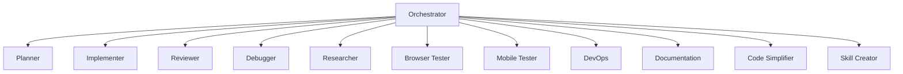

## Architecture

**Hub-and-spoke**: Orchestrator coordinates 11 specialists. Never executes work — only classifies, routes, tracks state.

---

## Agents

| Agent | Role | Delegated When | Definition |
|-------|------|----------------|------------|
| **Orchestrator** | Workflow coordination (Phases 0-4) | Every task (entry point) | [`.apm/agents/gem-orchestrator.agent.md`](/.apm/agents/gem-orchestrator.agent.md) |
| **Planner** | Wave plans for MEDIUM/HIGH | Multi-task, dependent, or risky work | [`.apm/agents/gem-planner.agent.md`](/.apm/agents/gem-planner.agent.md) |
| **Implementer** | TDD implementation | Features, fixes, refactors | [`.apm/agents/gem-implementer.agent.md`](/.apm/agents/gem-implementer.agent.md) |
| **Reviewer** | Quality/security (3 axes: mode/target/scope) | Risk signals, explicit request | [`.apm/agents/gem-reviewer.agent.md`](/.apm/agents/gem-reviewer.agent.md) |
| **Debugger** | Root cause + reproduction test | Bug fixes, test failures, regressions | [`.apm/agents/gem-debugger.agent.md`](/.apm/agents/gem-debugger.agent.md) |
| **Researcher** | Codebase exploration (5 modes) | Planning context, standalone research | [`.apm/agents/gem-researcher.agent.md`](/.apm/agents/gem-researcher.agent.md) |
| **Browser Tester** | UI/E2E (visual, a11y, perf, contract) | UI features, visual regression | [`.apm/agents/gem-browser-tester.agent.md`](/.apm/agents/gem-browser-tester.agent.md) |
| **Code Simplifier** | Refactoring (dead code, complexity, dupes) | Explicit refactor, post-impl cleanup | [`.apm/agents/gem-code-simplifier.agent.md`](/.apm/agents/gem-code-simplifier.agent.md) |
| **DevOps** | Infra, CI/CD, deploy, health, rollback | Infrastructure, releases, pipelines | [`.apm/agents/gem-devops.agent.md`](/.apm/agents/gem-devops.agent.md) |
| **Documentation** | Tech docs, API docs, diagrams, PRDs | Docs creation, PRD updates | [`.apm/agents/gem-documentation-writer.agent.md`](/.apm/agents/gem-documentation-writer.agent.md) |
| **Mobile Tester** | iOS/Android E2E (Detox, Maestro, Appium) | Mobile features, release validation | [`.apm/agents/gem-mobile-tester.agent.md`](/.apm/agents/gem-mobile-tester.agent.md) |
| **Skill Creator** | Packages patterns into `SKILL.md` | ≥2 uses, confidence ≥0.95 | [`.apm/agents/gem-skill-creator.agent.md`](/.apm/agents/gem-skill-creator.agent.md) |

---

## Reviewer: Three Axes

| Axis | Values |
|------|--------|
| **review_mode** | `standard` \| `high` \| `critic` (read-only) |
| **review_target** | `plan` \| `task` \| `code` \| `decision` \| `docs` \| `config` \| `integration` |
| **review_scope** | `changed` \| `affected` \| `full` |

[Reviewer Routing Details](/agents/reviewer-routing)

---

## Model Routing (Optional)

| Tier | Agents | Purpose |
|------|--------|---------|
| **Premium** | Planner, Debugger, Reviewer | Reasoning: planning, diagnosis, challenge |
| **Explore** | Researcher, Implementer, Testers, DevOps, Docs, Skill Creator, Code Simplifier | Fast execution & exploration |

Enable in `.gem-team.yaml`. [Model Routing Details](/agents/model-routing)

---

## Packaged Skills

| Skill | Purpose | Activation | Source |
|-------|---------|------------|--------|
| `gem-devops-guidelines` | Deployment, CI/CD, health checks, rollback | DevOps, pipeline, release tasks | [`.apm/skills/gem-devops-guidelines/SKILL.md`](/.apm/skills/gem-devops-guidelines/SKILL.md) |

[Skills Details](/agents/skills)

---

## Related

- [Workflow](/guide/workflow) — Phase 0-4 execution
- [Core Concepts](/getting-started/concepts) — Handoffs, memory, waves
- [Configuration](/configuration) — Model routing, quality settings
- [First Steps](/getting-started/first-steps) — Agents in action