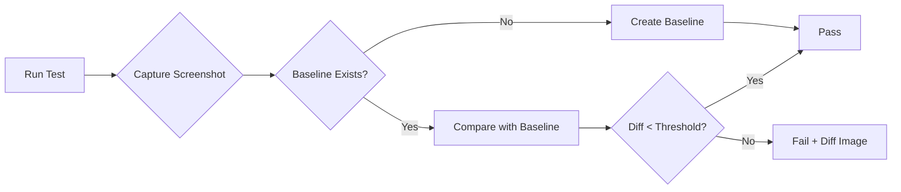

## Role

The Browser Tester validates **browser and UI flows** with conditional testing across visual, accessibility, performance, network, and regression dimensions.

---

## When Delegated

- UI feature implementation verification
- Visual regression testing (when enabled)
- Accessibility audit (when configured)
- API contract testing via browser
- Performance benchmarking
- Cross-browser validation

---

## Test Capabilities

| Dimension | What It Tests | Configuration |
|-----------|---------------|---------------|
| **Flow Assertions** | User journeys, form submissions, navigation | Acceptance criteria |
| **Visual Regression** | Screenshot comparison vs baseline | `quality.visual_regression_enabled`, threshold |
| **Accessibility** | WCAG 2.2 AA: contrast, ARIA, focus, touch targets | `quality.a11y_audit_level` |
| **Performance** | Cold-start TTI, memory, frame rate, bundle size | Acceptance criteria thresholds |
| **Network** | API calls, timing, error handling, caching | HAR capture, mock responses |
| **Contract** | API request/response matches OpenAPI spec | Schema validation |

---

## Input Handoff

```yaml
task_definition:
  objective: "Verify user search UI"
  acceptance_criteria:
    - "Search results render within 500ms"
    - "Pagination controls functional"
    - "Keyboard navigation works"
    - "Visual match baseline (threshold 0.95)"
  handoff:
    constraints:
      - "Test against staging environment"
      - "Use Chrome + Firefox"
    relevant_context:
      - "implement-search: api_contract=wave-3/implement-search/artifacts/api-contract.json"
      - "UI components: src/components/UserSearch.vue"
```

---

## Output

```yaml
status: "completed"
failure_classification: null
handoff:
  test_results:
    flow_assertions: "passed"
    visual_regression: "passed (diff: 0.02)"
    accessibility: "passed (WCAG 2.2 AA)"
    performance: "passed (TTI: 320ms)"
    network: "passed (0 failed requests)"
    contract: "passed (OpenAPI valid)"
  artifacts:
    screenshots: "wave-4/browser-test/artifacts/screenshots/"
    har_file: "wave-4/browser-test/artifacts/network.har"
    a11y_report: "wave-4/browser-test/artifacts/a11y-report.json"
    performance_metrics: "wave-4/browser-test/artifacts/perf-metrics.json"
```

---

## Conditional Testing

Tests run **only when relevant**:

```yaml
# Visual regression only if enabled + baseline exists
visual_regression_enabled: true
baseline_exists: true

# A11y only if level > none
a11y_audit_level: "basic"  # or "full"

# Performance only if thresholds in criteria
acceptance_criteria:
  - "TTI < 500ms"
  - "Bundle size < 200KB"
```

---

## Visual Regression Workflow



---

## Accessibility Levels

| Level | Checks |
|-------|--------|
| `none` | No a11y checks |
| `basic` | Contrast (4.5:1), ARIA labels, focus indicators, touch targets (44pt/48dp) |
| `full` | All basic + reduced motion, semantic HTML, screen reader testing, keyboard navigation |

---

## Key Rules

1. **Conditional execution** — Tests only run when configured + relevant
2. **Evidence by reference** — Artifacts in task paths (screenshots, HAR, reports)
3. **Contract validation** — API calls matched against OpenAPI spec
4. **Cross-browser** — Chrome + Firefox minimum when specified
5. **CI-ready output** — JUnit XML, JSON reports for pipeline integration

---

## Related Pages

- [Quality Features](/guide/quality) — Visual regression and a11y config
- [Workflow: Execute](/guide/workflow-execute) — Browser Tester in wave loop
- [Configuration](/configuration) — Quality settings
- [First Steps](/getting-started/first-steps) — Browser Tester in walkthrough