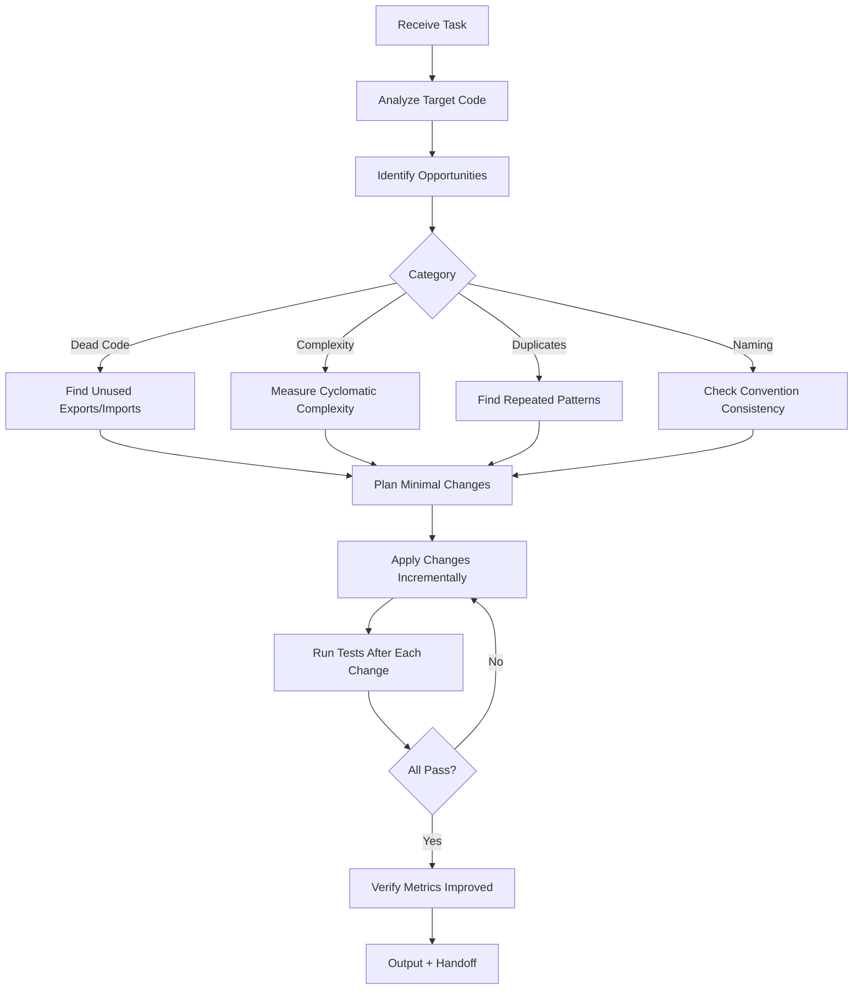

## Role

The Code Simplifier handles **targeted refactoring** — dead code removal, complexity reduction, duplicate consolidation, naming improvements. Every refactoring has a one-line reason.

---

## When Delegated

- Explicit refactoring tasks
- Post-implementation cleanup (when requested)
- Complexity reduction for maintainability
- Dead code elimination
- Naming standardization

---

## Refactoring Categories

| Category | What It Does | Validation |
|----------|--------------|------------|
| **Dead Code** | Removes unused exports, functions, imports, files | Tests pass, no reference breaks |
| **Complexity** | Reduces cyclomatic complexity, splits large functions | Complexity metrics improve |
| **Duplicates** | Consolidates repeated patterns into helpers | Single source of truth |
| **Naming** | Improves variable, function, class names for clarity | Consistent with codebase conventions |

---

## Input Handoff

```yaml
task_definition:
  objective: "Simplify user search implementation"
  acceptance_criteria:
    - "Reduce cyclomatic complexity of search.ts from 15 to <10"
    - "Remove duplicate validation logic"
    - "Standardize error handling with ApiError class"
  handoff:
    constraints:
      - "Preserve all existing behavior"
      - "All tests must pass"
      - "Follow existing patterns in codebase"
    relevant_context:
      - "implement-search: files=src/api/users/search.ts, tests/api/users/search.test.ts"
```

---

## Output

```yaml
status: "completed"
failure_classification: null
handoff:
  refactored_files:
    - "src/api/users/search.ts"
    - "src/validation/search.ts"  # New consolidated validation
  removed_files:
    - "src/api/users/legacy-validation.ts"
  changes:
    - file: "src/api/users/search.ts"
      change: "Extracted validation to shared module"
      reason: "Duplicate validation logic in 3 endpoints"
      complexity_before: 15
      complexity_after: 7
    - file: "src/api/users/search.ts"
      change: "Replaced inline error handling with ApiError"
      reason: "Consistent error handling across API layer"
  test_results: "all_passed"
```

---

## Refactoring Process



---

## Key Principles

| Principle | Application |
|-----------|-------------|
| **One-line reasons** | Every change has documented rationale |
| **No buzzwords** | "Clean code", "best practice" not accepted as reasons |
| **Preserve intent** | Respect existing design decisions |
| **Tests as spec** | Behavior verified by existing tests |
| **Remove AI-slop comments** | No "this function does X" comments |
| **Minimal diff** | Smallest change achieving criteria |

---

## What It Doesn't Do

- **No architecture redesign** — That's Planner/Reviewer territory
- **No feature changes** — Only structural improvements
- **No speculative abstraction** — YAGNI enforced
- **No style-only changes** — Unless consistency violation

---

## Validation Checks

Every refactoring verified:
1. **All existing tests pass**
2. **Complexity metrics improved** (cyclomatic, cognitive, nesting)
3. **No dead references** (imports, exports, function calls)
4. **Naming consistent** with codebase conventions
5. **No behavior change** (verified by test suite)

---

## Key Rules

1. **One-line reason per change** — Mandatory
2. **No buzzwords as justification** — Concrete rationale required
3. **Tests are the spec** — Behavior preserved via test suite
4. **Minimal diff** — Smallest change satisfying criteria
5. **Evidence by reference** — Changed files, metrics, test results in artifacts

---

## Related Pages

- [Implementer](/agents/implementer) — Implements features, Simplifier refactors
- [Reviewer](/agents/reviewer) — Over-engineering pass catches what Simplifier fixes
- [Workflow: Execute](/guide/workflow-execute) — Where Simplifier runs
- [Optimizations](/guide/optimizations) — Proportional architecture principle