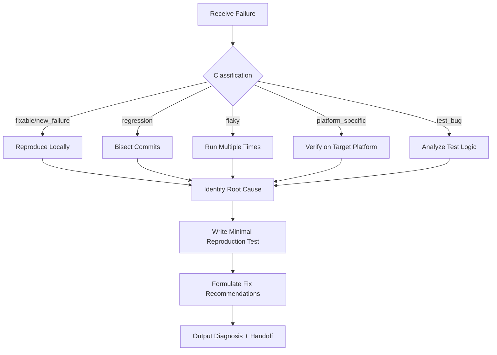

## Role

The Debugger handles **failure diagnosis** — reproduces issues, finds root causes, bisects regressions, and provides fix recommendations with minimal reproduction tests. Never implements fixes.

---

## When Delegated

- Bug fixes (`fixable`, `regression`, `new_failure` classifications)
- Test failures (`test_bug` classification)
- Regression bisection
- Flaky test investigation
- Platform-specific failures

---

## Input Handoff

```yaml
# For fixable/regression/new_failure
failure: "TypeError: Cannot read property 'email' of undefined"
expected_behavior: "User object returned with email field"
evidence:
  - "Stack trace: src/api/users/search.ts:45:12"
  - "Failing test: tests/api/users/search.test.ts:23"
  - "Recent change: src/models/user.ts email field made optional"

# For regression bisection
failure: "Auth tests passing at commit abc123, failing at HEAD"
expected_behavior: "All auth tests pass"
evidence:
  - "Test suite: tests/auth/"
  - "Known good: abc123 (2025-01-10)"
  - "Known bad: HEAD"
```

---

## Output: Diagnosis + Reproduction Test + Fix Recommendation

```yaml
status: "completed"
failure_classification: "fixable"
handoff:
  debugger_diagnosis:
    root_cause: "User model email field made optional but search endpoint assumes required"
    evidence:
      - "src/models/user.ts: email field changed to optional (PR #234)"
      - "src/api/users/search.ts:45 accesses user.email without null check"
      - "Test assumes email always present"
    fix_recommendations:
      - "Add null check: user.email ?? 'unknown'"
      - "Update Zod response schema to make email optional"
      - "Add test for user without email"
    reproduction_test: "tests/debug/reproduction-user-email.test.ts"
    confidence: 0.98
```

---

## Debugging Process



---

## Key Capabilities

### Reproduction First
- **Always writes minimal reproduction test** before recommending fix
- Test fails before fix, passes after
- Isolates exact failure condition

### Regression Bisection
- Automated git bisect between known good/bad commits
- Identifies exact commit introducing regression
- Provides commit diff + impact analysis

### Flaky Test Analysis
- Runs test multiple times (default: 10)
- Captures timing, ordering, environment factors
- Classifies flakiness type (timing, state, external, non-deterministic)

### Platform-Specific Verification
- Verifies criteria on target platform
- Identifies platform-specific code paths
- Recommends platform-agnostic fixes

---

## Fix Recommendation Format

Each recommendation includes:
```yaml
fix_recommendations:
  - action: "Add null check before accessing user.email"
    file: "src/api/users/search.ts"
    line: 45
    reason: "Email field now optional in user model"
    risk: "low"
    test_to_add: "User without email returns 'unknown'"
```

---

## Output Constraints

- **Never implements** — only diagnoses and recommends
- **Minimal reproduction test** — single test case isolating failure
- **Confidence scored** — 0.0-1.0 on root cause identification
- **Evidence referenced** — File paths, line numbers, commit SHAs

---

## Key Rules

1. **Reproduction test mandatory** — No fix recommendation without it
2. **Never implements** — Handoff to Implementer for fix
3. **Bisect for regressions** — Automated commit bisection
4. **Confidence scored** — Root cause confidence 0.0-1.0
5. **Evidence by reference** — File paths, not content
6. **Single root cause focus** — One primary cause per diagnosis

---

## Related Pages

- [Implementer](/agents/implementer) — Receives Debugger handoff for fixes
- [Failure Handling](/guide/failure-handling) — Classification taxonomy
- [Workflow: Execute](/guide/workflow-execute) — Where Debugger runs
- [First Steps](/getting-started/first-steps) — Debugger in action