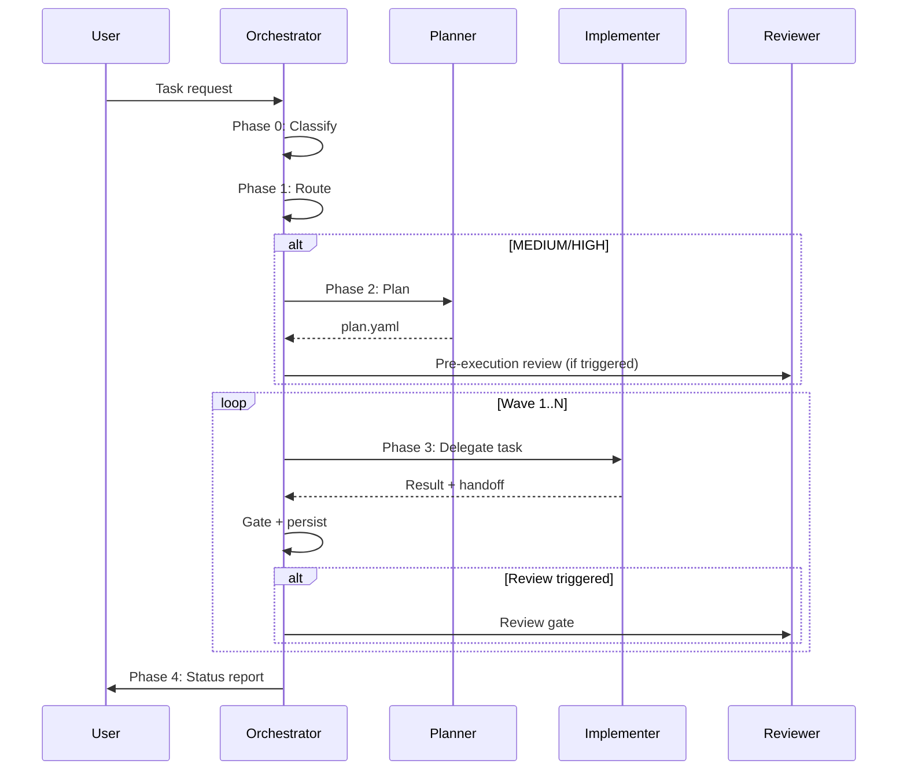

## Role

The Orchestrator is the **entry point for every task** and the only agent that interacts directly with the user. It never executes specialist work — it coordinates, classifies, delegates, and reports.

---

## Responsibilities

| Area | What It Does |
|------|--------------|
| **Classification (Phase 0)** | Parses request, assigns `plan_id`, `request_state`, `intent`, provisional complexity, risk signals |
| **Routing (Phase 1)** | Fast path vs full plan, research path, challenge path, continue/extend handling |
| **Planning (Phase 2)** | Delegates to Planner for MEDIUM/HIGH; runs mechanical self-check; routes to Reviewer if needed |
| **Execution (Phase 3)** | Wave loop: schedule → delegate → gate → persist → next wave |
| **Output (Phase 4)** | Structured status report, memory promotion, skill extraction |
| **Failure Handling** | Classifies every failure, routes to correct handler (Debugger, Planner, escalate) |
| **Memory Management** | Promotes stable findings (confidence ≥ 0.95) to repo/session/global memory |
| **Relational Invariant Fallbacks** | Infers intent when agent output misses conditional fields |

---

## Key Behaviors

### Never Executes Specialist Work
- No code writing, no debugging, no testing, no research execution
- Only: classify, route, synthesize, ask user, report status

### Evidence-Only Classification
- Phase 0 uses **only request + supplied evidence + continuity memory**
- No repository inspection, no delegation to improve confidence
- Classifies once, routes immediately

### Scoped Delegation
- Each task gets minimal handoff: plan-constant → cluster-shared → per-task → per-attempt
- Cache-lifetime field ordering for maximum prefix reuse
- Specialists receive only what they need

### Failure Classification (No Blind Retries)
Every failure gets a specific classification:
- `needs_retry` → Retry same task (max 3x)
- `fixable`/`regression`/`new_failure` → Debugger → Implementer
- `needs_replan` → Planner (bounded replan)
- `flaky` → Specialist re-runs once
- `platform_specific` → Specialist verifies criteria
- `test_bug` → Debugger → Implementer
- `blocked`/`escalate` → Stop, escalate to user

---

## Input/Output

### Input (Every Task)
```yaml
plan_id: "20250115-user-search-api"
request_state: "new_task"  # new_task | continue_plan | extend
intent: "execute"          # execute | debug | research | discuss | challenge
objective: "Add user search endpoint..."
acceptance_criteria: [...]
constraints: [...]
```

### Output (Execution Status)
```markdown
## Execution Status

Plan: `20250115-user-search-api` | Add user search endpoint
Progress: `5/5` tasks (100%)
Waves: Wave 3 (2/2)
Blocked: 0
Next: Complete

## Promoted Learnings
| Finding | Confidence | Source | Tier |
|---------|------------|--------|------|
| Pagination helper reusable | 0.98 | implement-search | repo |
```

---

## Configuration

```yaml
# .gem-team.yaml
orchestrator:
  max_concurrent_agents: 2          # Parallel task limit
  git_commit_on_gate_pass: false    # Auto-commit on review pass

model_routing:
  enabled: false                    # Enable tier-based model selection
  tiers:
    premium: "gpt-5.6-sol (openai)"
    explore: "gpt-5.6-luna (openai)"
```

---

## Interaction Flow



---

## Key Rules

1. **Never executes specialist work** — Only coordinates
2. **Classifies from evidence only** — No repo inspection in Phase 0
3. **Exact plan_id required** — For continue/extend, no inference
4. **Fast path when eligible** — Single owner, bounded scope, clear criteria, no risk
5. **Relational invariant fallbacks** — Infer intent, don't reject valid work
6. **Memory promotion after success only** — Confidence ≥ 0.95
7. **Structured output always** — Standard format for all intents

---

## Related Pages

- [Workflow](/guide/workflow) — Phases 0-4 in detail
- [Phase 0: Init & Clarify](/guide/init-clarify) — Classification logic
- [Phase 3: Execute](/guide/workflow-execute) — Wave loop and delegation
- [Failure Handling](/guide/failure-handling) — Classification taxonomy
- [Core Concepts](/getting-started/concepts) — Handoffs, memory, waves