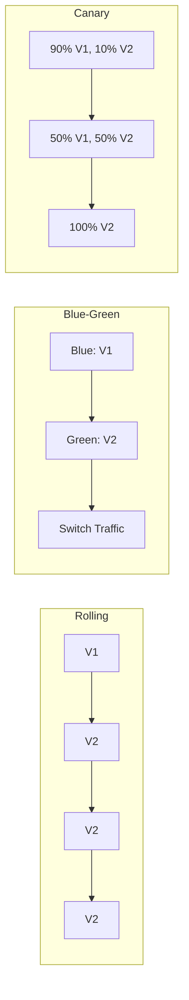

## Configuration

```yaml
devops:
  approval_required_for: [production]
  deployment_strategy: rolling
  auto_rollback_on_failure: false
```

## Settings

| Setting                           | Type    | Default        | Description                                 |
| --------------------------------- | ------- | -------------- | ------------------------------------------- |
| `devops.approval_required_for`    | enum[]  | `[production]` | Environments requiring explicit approval    |
| `devops.deployment_strategy`      | enum    | `rolling`      | Strategy: `rolling`, `blue_green`, `canary` |
| `devops.auto_rollback_on_failure` | boolean | `false`        | Attempt rollback after deployment failure   |

## Approval Gates

| Environment   | Default      | Configurable |
| ------------- | ------------ | ------------ |
| `production`  | Required     | Yes          |
| `staging`     | Not required | Yes          |
| `development` | Not required | Yes          |
| Custom        | Not required | Yes          |

```yaml
# Require approval for staging + production
devops:
  approval_required_for: [staging, production]
```

## Deployment Strategies

| Strategy       | Description               | Rollback Speed | Use Case                                |
| -------------- | ------------------------- | -------------- | --------------------------------------- |
| **rolling**    | Gradual pod replacement   | Medium         | Stateless services, zero-downtime       |
| **blue_green** | Full parallel environment | Instant        | Critical services, instant rollback     |
| **canary**     | Gradual traffic shift     | Fast           | Risk mitigation, metric-based promotion |

### Strategy Comparison



## Auto Rollback

When `auto_rollback_on_failure: true`:

- Triggers on health check failure post-deployment
- Rolls back to previous stable version
- Requires `deployment_strategy: blue_green` or `canary` for instant rollback
- Rolling strategy rolls back via reverse rolling update

## Example: Deploy User Search API to Staging

```yaml
# Task input to gem-devops
objective: "Deploy user search API to staging"
acceptance_criteria:
  - "Staging deploy succeeds"
  - "Health checks pass on /health"
  - "Smoke tests pass"
  - "Rollback procedure tested"
handoff:
  constraints:
    ["Existing K8s cluster", "Approval for prod not needed for staging"]
  relevant_context:
    - "image=myapp:v1.2.3"
    - "cluster=staging"
```

**Expected output:**

```yaml
status: "completed"
handoff:
  deployment:
    {
      environment: "staging",
      strategy: "blue_green",
      url: "https://staging.example.com",
    }
  health_checks: [{ endpoint: "/health", status: "passed", latency_ms: 45 }]
  smoke_tests: "passed"
  rollback_verified: true
  approval_required_for_production: true
```

## Key Rules

1. **Production always requires approval** unless explicitly disabled
2. **Blue-green/canary enable instant rollback** — Rolling is slower
3. **Health checks mandatory** — No deployment without verification
4. **Approval gates enforced by DevOps agent** — Not configurable at runtime

## Related Pages

- [DevOps Agent](/agents/devops) — Infrastructure and deployment execution
- [Workflow: Execute](/guide/workflow-execute) — DevOps in wave loop
- [Resources: Operational Notes](/resources/operational-notes) — Production practices
- [Configuration Overview](/configuration) — Full config reference
